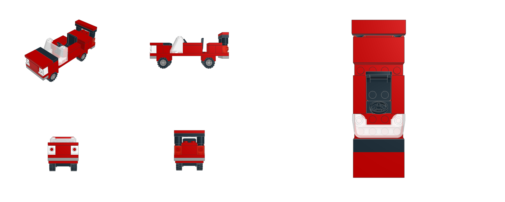

# LEGO sports car (built with ldraw-nova)

An original classic 4-wide LEGO Town roadster, 12 studs long, built with the `/lego` skill in this repo.

- `sports-car.html`: interactive 3D viewer, a single file that works offline. Orbit, zoom, **Drive** (wheels spin), spin and edges.
- `sports-car.mpd`: the LDraw model. Open it in BrickLink Studio, LeoCAD or LDCad for building steps.
- `tools/sports_car_gen.py` → `sports-car.plan.json`: editable source (`python tools/sports_car_gen.py`).
- `tools/groups.json` + `tools/add_drive_button.py`: how the wheel animation was added to the generic viewer.
- `PARTS.md` / `bom.json`: parts list (40 parts). `validation.json`: geometry checks. `previews/`: LeoCAD renders.

Design: red body, classic wheel-pin running gear (4600 holders, 4624 rims, 3641 tyres, 7-stud wheelbase) under 2×4 car mudguards, a 4×12 chassis plate, tiled bonnet with a black cowl, raked 2×4×2 windscreen, open cockpit with seat and steering wheel, white headlight bricks, trans-red tail lights and a black rear spoiler.

Check notes: all parts sit on the stud grid and nothing collides. Some parts (1×3 / 1×2 bricks, headlight bricks, steering wheel) only have "potential" connector data in ldraw-nova, so they show as separate groups even though they sit exactly on their studs. The row behind the seat is left open because the seat back leans into it.
Checks passing does not prove the real model is buildable.
