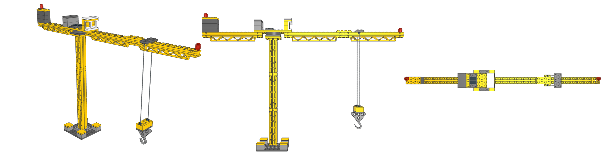

# LEGO tower crane (built with ldraw-nova)

An original flat-top construction tower crane, generated with [ldraw-nova](https://github.com/anteloc/ldraw-nova).

- `tower-crane.mpd` — the LDraw model. Open it in LeoCAD, LDCad, BrickLink Studio or LDView.
- `tower_crane_gen.py` → `tower-crane.plan.json` — editable source (regenerate with `python tower_crane_gen.py`).
- `PARTS.md` / `bom.json` — parts list. `validation.json` — geometry checks.

Size: about 54 studs long (jib tip to counter-jib) and 30 bricks tall.

Not stud-connected (visual only): the two hoist rope falls (braided string), the hook block hanging from them, and the hook.
Checks passing does not prove the real model is buildable or strong.
