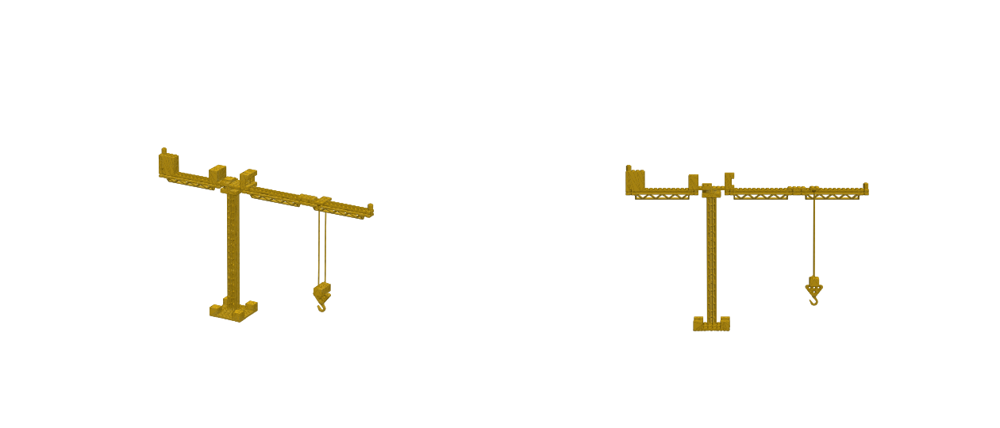

# 3D-printing the tower crane

| File | Use |
|---|---|
| `tower-crane-display-50pct-watertight.stl` | **Print this one.** The whole crane as one solid, 50% scale: 217 × 32 × 147 mm, about 26 cm³. Watertight (rebuilt on a 0.3 mm grid). |
| `tower-crane-display.stl` | Whole crane at real LEGO size (432 × 64 × 293 mm), raw LDraw mesh. Scale in your slicer; let it auto-repair. |
| `parts/*.stl` | Each of the 18 LEGO parts at real size (1 LDU = 0.4 mm), raw LDraw meshes. `report.json` lists sizes and quantities. |

## Printing tips (display model)

- **Orientation:** lay it on its side (rotate 90° about the long axis) so the jib lies flat on the bed. Printed upright, the 10 cm jib is a huge overhang.
- **Supports:** on (tree supports work well) for the hook, hook block and the girder undersides.
- **Ropes** are about 1.6 mm thick at 50%. Use 0.2 mm layers and slow outer walls, or snip them off and use real thread.
- PLA, 0.4 mm nozzle, 15% infill is fine. Paint yellow / grey afterwards, or pause for colour swaps.

## Printing real LEGO-compatible parts

`parts/` are exact LDraw geometry, but printed bricks rarely clutch like real LEGO. FDM needs about 0.1–0.2 mm of tolerance tuning, and the raw meshes have open edges (T-junctions) that slicers normally repair automatically. They're best for the special pieces (girders 30646 / 30518, turntable, hook). Standard bricks and plates are cheaper to buy.
LEGO® is a trademark of the LEGO Group, which does not sponsor or endorse this project.
